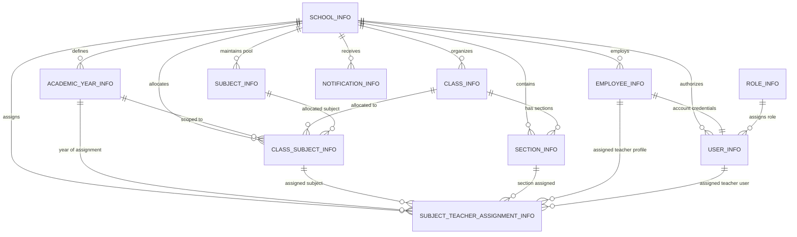

# Digital Marksheet Management System (DMMS) — Data Dictionary

> This document provides the complete, authoritative reference of all database collections, schemas, fields, relationships, and indexes implemented in MongoDB via Mongoose for DMMS.

---

## 📐 High-Level Entity Relationship Diagram (ERD)

---

## 🗄️ Collections Reference

---

### 1. `school_info`
* **Mongoose Model**: `SchoolInfo`
* **Collection Name**: `school_info`
* **Purpose**: Stores multi-tenant institutional records, generated school credentials hash, contact persons, and terms acceptance.

| Field Name | Data Type | Required | Default Value | Enum / Allowed Values | References / Relations | Purpose & Notes |
|---|---|---|---|---|---|---|
| `_id` | ObjectId | Yes (auto) | Auto-generated | — | Primary Key | MongoDB Unique Identifier |
| `schoolId` | String | Yes | — | — | Unique Index | Institutional unique ID (e.g. `KBPS_001`), uppercase, trimmed |
| `schoolCode` | String | Yes | — | — | — | Abbreviated uppercase school code (e.g. `KBPS`) |
| `schoolName` | String | Yes | — | — | — | Full institutional name |
| `establishedYear` | Number | Yes | — | — | — | Year school was founded |
| `email` | String | Yes | — | — | Unique Index | Official school email address, lowercase, trimmed |
| `mobileNumber` | String | Yes | — | — | — | Official school contact mobile |
| `address` | String | Yes | — | — | — | Complete physical address of the institution |
| `websiteUrl` | String | No | `''` | — | — | School website address |
| `schoolLogoUrl` | String | No | `''` | — | — | Path to uploaded school institutional logo image (Module 4 Phase 6) |
| `passwordHash` | String | Yes | — | — | — | Bcrypt hash of generated school password |
| `mustChangePassword`| Boolean | No | `false` | — | — | Indicates if initial school password change is required |
| `contactPersons` | Array [Subdoc] | Yes | — | Min: 2, Max: 3 | Embedded | 2 to 3 contact persons with fullName, email, mobileNumber, designation |
| `termsAccepted` | Boolean | Yes | `true` | — | — | Legal terms and conditions acceptance |
| `termsAcceptedAt` | Date | No | `Date.now` | — | — | Timestamp of registration agreement |
| `status` | String | No | `'ACTIVE'` | `'ACTIVE'`, `'INACTIVE'` | — | Operational status of the school |
| `createdAt` | Date | Yes (auto) | Current Date | — | — | Record creation timestamp |
| `updatedAt` | Date | Yes (auto) | Current Date | — | — | Last modification timestamp |

**Indexes**:
* `{ schoolId: 1 }` (Unique)
* `{ email: 1 }` (Unique)

---

### 2. `academic_year_info`
* **Mongoose Model**: `AcademicYearInfo`
* **Collection Name**: `academic_year_info`
* **Purpose**: Tracks school-specific academic calendar sessions (e.g. 2026–2027) and identifies the current active session.

| Field Name | Data Type | Required | Default Value | Enum / Allowed Values | References / Relations | Purpose & Notes |
|---|---|---|---|---|---|---|
| `_id` | ObjectId | Yes (auto) | Auto-generated | — | Primary Key | Unique Identifier |
| `schoolRef` | ObjectId | Yes | — | — | Ref: `SchoolInfo` | Reference to parent school document |
| `schoolId` | String | Yes | — | — | — | Multi-tenant isolation key |
| `yearCode` | String | Yes | — | — | — | Short identifier code (e.g. `AY-2026-27`) |
| `yearName` | String | Yes | — | — | — | Descriptive session label (e.g. `Academic Year 2026-2027`) |
| `startDate` | Date | Yes | — | — | — | Session start date |
| `endDate` | Date | Yes | — | — | — | Session end date |
| `isCurrent` | Boolean | No | `false` | — | — | Identifies active academic year for the school |
| `status` | String | No | `'ACTIVE'` | `'ACTIVE'`, `'COMPLETED'`, `'UPCOMING'` | — | Lifecycle status of the academic year |
| `createdAt` | Date | Yes (auto) | Current Date | — | — | Record creation timestamp |
| `updatedAt` | Date | Yes (auto) | Current Date | — | — | Last modification timestamp |

---

### 3. `class_info`
* **Mongoose Model**: `ClassInfo`
* **Collection Name**: `class_info`
* **Purpose**: Manages classes / grades offered by the school, associated class teacher, planned sections count, and auto-computed capacity.

| Field Name | Data Type | Required | Default Value | Enum / Allowed Values | References / Relations | Purpose & Notes |
|---|---|---|---|---|---|---|
| `_id` | ObjectId | Yes (auto) | Auto-generated | — | Primary Key | Unique Identifier |
| `schoolRef` | ObjectId | Yes | — | — | Ref: `SchoolInfo` | Reference to parent school document |
| `schoolId` | String | Yes | — | — | — | Multi-tenant isolation key |
| `classCode` | String | Yes | — | — | — | Uppercase identifier (e.g. `CLASS-1`, `GRADE-5`) |
| `className` | String | Yes | — | — | — | Display name (e.g. `Class 1`, `Grade 5`) |
| `classTeacherRef`| ObjectId | No | `null` | — | Ref: `EmployeeInfo` | Assigned Class Teacher employee profile |
| `classTeacherName`| String | No | `''` | — | — | Cached full name of assigned Class Teacher |
| `numberOfSections`| Number | Yes | `1` | Min: 0 | — | Planned count of sections |
| `totalCapacity` | Number | No | `0` | Min: 0 | — | Auto-aggregated sum of section capacities |
| `status` | String | No | `'ACTIVE'` | `'ACTIVE'`, `'INACTIVE'` | — | Class status |
| `createdAt` | Date | Yes (auto) | Current Date | — | — | Record creation timestamp |
| `updatedAt` | Date | Yes (auto) | Current Date | — | — | Last modification timestamp |

**Indexes**:
* `{ schoolId: 1, classCode: 1 }` (Unique within school)

---

### 4. `section_info`
* **Mongoose Model**: `SectionInfo`
* **Collection Name**: `section_info`
* **Purpose**: Represents sections under a specific class, associated section teacher, and maximum student intake.

| Field Name | Data Type | Required | Default Value | Enum / Allowed Values | References / Relations | Purpose & Notes |
|---|---|---|---|---|---|---|
| `_id` | ObjectId | Yes (auto) | Auto-generated | — | Primary Key | Unique Identifier |
| `schoolRef` | ObjectId | Yes | — | — | Ref: `SchoolInfo` | Reference to parent school |
| `schoolId` | String | Yes | — | — | — | Multi-tenant isolation key |
| `classRef` | ObjectId | Yes | — | — | Ref: `ClassInfo` | Parent Class reference |
| `classCode` | String | Yes | — | — | — | Cached class code |
| `className` | String | Yes | — | — | — | Cached class name |
| `sectionCode` | String | Yes | — | — | — | Uppercase section identifier (e.g. `A`, `B`, `C`) |
| `sectionName` | String | Yes | — | — | — | Descriptive section name (e.g. `Section A`) |
| `sectionTeacherRef` | ObjectId | No | `null` | — | Ref: `EmployeeInfo` | Assigned Section Teacher employee profile |
| `sectionTeacherName` | String | No | `''` | — | — | Cached name of assigned Section Teacher |
| `maxCapacity` | Number | Yes | — | Min: 1 | — | Maximum student capacity of this section |
| `status` | String | No | `'ACTIVE'` | `'ACTIVE'`, `'INACTIVE'` | — | Section status |
| `createdAt` | Date | Yes (auto) | Current Date | — | — | Record creation timestamp |
| `updatedAt` | Date | Yes (auto) | Current Date | — | — | Last modification timestamp |

**Indexes**:
* `{ schoolId: 1, classRef: 1, sectionCode: 1 }` (Unique within class and school)

---

### 5. `subject_info`
* **Mongoose Model**: `SubjectInfo`
* **Collection Name**: `subject_info`
* **Purpose**: Common institutional subject pool defining all scholastic and co-scholastic subjects taught in the school.

| Field Name | Data Type | Required | Default Value | Enum / Allowed Values | References / Relations | Purpose & Notes |
|---|---|---|---|---|---|---|
| `_id` | ObjectId | Yes (auto) | Auto-generated | — | Primary Key | Unique Identifier |
| `schoolRef` | ObjectId | Yes | — | — | Ref: `SchoolInfo` | Reference to parent school |
| `schoolId` | String | Yes | — | — | — | Multi-tenant isolation key |
| `subjectCode` | String | Yes | — | — | — | Uppercase subject code (e.g. `MATH-101`) |
| `subjectName` | String | Yes | — | — | — | Subject title (e.g. `Mathematics`) |
| `subjectType` | String | Yes | — | `'ACADEMIC'`, `'CO_CURRICULAR'` | — | Categorizes Scholastic vs Co-Scholastic |
| `status` | String | No | `'ACTIVE'` | `'ACTIVE'`, `'INACTIVE'` | — | Subject status in pool |
| `createdAt` | Date | Yes (auto) | Current Date | — | — | Record creation timestamp |
| `updatedAt` | Date | Yes (auto) | Current Date | — | — | Last modification timestamp |

**Indexes**:
* `{ schoolId: 1, subjectCode: 1 }` (Unique within school)

---

### 6. `class_subject_info` *(Implemented in Module 3 – Phase 1)*
* **Mongoose Model**: `ClassSubjectInfo`
* **Collection Name**: `class_subject_info`
* **Purpose**: Records subject allocations to specific classes for an individual academic year, including additional/project work mark components that contribute to final results independently of examinations.

| Field Name | Data Type | Required | Default Value | Enum / Allowed Values | References / Relations | Purpose & Notes |
|---|---|---|---|---|---|---|
| `_id` | ObjectId | Yes (auto) | Auto-generated | — | Primary Key | Unique Identifier |
| `schoolRef` | ObjectId | Yes | — | — | Ref: `SchoolInfo` | Reference to parent school document |
| `schoolId` | String | Yes | — | — | — | Multi-tenant isolation key |
| `academicYearRef` | ObjectId | Yes | — | — | Ref: `AcademicYearInfo` | Academic session for this allocation |
| `classRef` | ObjectId | Yes | — | — | Ref: `ClassInfo` | Target Class allocated to |
| `subjectRef` | ObjectId | Yes | — | — | Ref: `SubjectInfo` | Allocated Subject from school pool |
| `subjectCode` | String | Yes | — | — | — | Cached subject code (uppercase) |
| `subjectName` | String | Yes | — | — | — | Cached subject display name |
| `subjectType` | String | Yes | — | `'ACADEMIC'`, `'CO_CURRICULAR'` | — | Inherited subject classification |
| `hasAdditionalComponents` | Boolean | No | `false` | — | — | Indicates if additional/project components exist |
| `additionalComponents` | Array [Subdoc] | No | `[]` | — | Embedded Schema | List of components (componentName, maximumMarks) |
| `additionalComponents.componentName` | String | Yes (when enabled) | — | — | — | Component label (e.g. `Project Work`, `Oral`) |
| `additionalComponents.maximumMarks` | Number | Yes (when enabled) | — | Min: 1 | — | Maximum marks for this additional component |
| `totalAdditionalMarks` | Number | No | `0` | Min: 0 | — | Sum of all maximumMarks in additionalComponents |
| `status` | String | No | `'ACTIVE'` | `'ACTIVE'`, `'INACTIVE'` | — | Allocation status |
| `createdAt` | Date | Yes (auto) | Current Date | — | — | Record creation timestamp |
| `updatedAt` | Date | Yes (auto) | Current Date | — | — | Last modification timestamp |

**Indexes**:
* `{ schoolId: 1, academicYearRef: 1, classRef: 1, subjectRef: 1 }` (**Compound Unique**: prevents duplicate allocation of the same subject to the same class in the same academic year)
* `{ schoolId: 1, academicYearRef: 1, classRef: 1, status: 1 }` (Lookup index for fast class subject queries)

---

### 7. `subject_teacher_assignment_info` *(Implemented in Module 3 – Phase 2)*
* **Mongoose Model**: `SubjectTeacherAssignmentInfo`
* **Collection Name**: `subject_teacher_assignment_info`
* **Purpose**: Records teacher assignments to individual subjects within specific class sections for an academic year, with automated notification dispatch to all relevant staff.

| Field Name | Data Type | Required | Default Value | Enum / Allowed Values | References / Relations | Purpose & Notes |
|---|---|---|---|---|---|---|
| `_id` | ObjectId | Yes (auto) | Auto-generated | — | Primary Key | Unique Identifier |
| `schoolRef` | ObjectId | Yes | — | — | Ref: `SchoolInfo` | Parent school document reference |
| `schoolId` | String | Yes | — | — | — | Multi-tenant isolation key |
| `academicYearRef` | ObjectId | Yes | — | — | Ref: `AcademicYearInfo` | Academic session for this assignment |
| `classSubjectRef` | ObjectId | Yes | — | — | Ref: `ClassSubjectInfo` | Allocated class subject reference |
| `classRef` | ObjectId | Yes | — | — | Ref: `ClassInfo` | Target Class |
| `sectionRef` | ObjectId | Yes | — | — | Ref: `SectionInfo` | Target Section under the class |
| `subjectRef` | ObjectId | Yes | — | — | Ref: `SubjectInfo` | Subject from school pool |
| `teacherEmployeeRef` | ObjectId | Yes | — | — | Ref: `EmployeeInfo` | Assigned teacher employee profile |
| `teacherUserRef` | ObjectId | Yes | — | — | Ref: `UserInfo` | Assigned teacher login account |
| `classCode` | String | Yes | — | — | — | Cached uppercase class code |
| `className` | String | Yes | — | — | — | Cached class display name |
| `sectionCode` | String | Yes | — | — | — | Cached uppercase section code |
| `sectionName` | String | Yes | — | — | — | Cached section display name |
| `subjectCode` | String | Yes | — | — | — | Cached uppercase subject code |
| `subjectName` | String | Yes | — | — | — | Cached subject display name |
| `subjectType` | String | Yes | — | `'ACADEMIC'`, `'CO_CURRICULAR'` | — | Classification of subject |
| `teacherName` | String | Yes | — | — | — | Cached full name of assigned teacher |
| `teacherUserId` | String | Yes | — | — | — | Cached user ID (e.g. `ALAN_001`) |
| `teacherEmail` | String | Yes | — | — | — | Cached teacher contact email |
| `status` | String | No | `'ACTIVE'` | `'ACTIVE'`, `'INACTIVE'` | — | Assignment status |
| `createdAt` | Date | Yes (auto) | Current Date | — | — | Record creation timestamp |
| `updatedAt` | Date | Yes (auto) | Current Date | — | — | Last modification timestamp |

**Indexes**:
* `{ schoolId: 1, academicYearRef: 1, classRef: 1, sectionRef: 1, subjectRef: 1 }` (**Partial Compound Unique**: where `{ status: 'ACTIVE' }`, strictly preventing multiple active teachers for the same subject, section, class, and academic year)
* `{ schoolId: 1, academicYearRef: 1, teacherEmployeeRef: 1 }` (Lookup for teacher schedules)
* `{ schoolId: 1, classRef: 1, sectionRef: 1 }` (Lookup for class-section rosters)

---

### 8. `employee_info`
* **Mongoose Model**: `EmployeeInfo`
* **Collection Name**: `employee_info`
* **Purpose**: Profiles staff members, qualifications, designations, and contact numbers.

| Field Name | Data Type | Required | Default Value | References / Relations | Purpose & Notes |
|---|---|---|---|---|---|
| `_id` | ObjectId | Yes (auto) | Auto-generated | Primary Key | Unique Identifier |
| `schoolRef` | ObjectId | Yes | — | Ref: `SchoolInfo` | Parent school document reference |
| `schoolId` | String | Yes | — | — | Multi-tenant isolation key |
| `fullName` | String | Yes | — | — | Employee's legal full name |
| `email` | String | Yes | — | — | Contact email address |
| `mobileNumber` | String | Yes | — | — | Contact mobile number |
| `designation` | String | Yes | — | — | Job title (e.g. `Senior Mathematics Teacher`) |
| `profileImage` | String | No | `null` | — | Relative path to uploaded image file |
| `address` | String | No | `''` | — | Residential address |
| `qualification` | String | No | `''` | — | Educational background / degrees |
| `joiningDate` | Date | No | `Date.now` | — | Date of joining |
| `createdAt` | Date | Yes (auto) | Current Date | — | Record creation timestamp |
| `updatedAt` | Date | Yes (auto) | Current Date | — | Last modification timestamp |

---

### 9. `user_info`
* **Mongoose Model**: `UserInfo`
* **Collection Name**: `user_info`
* **Purpose**: Authentication records, login credentials, assigned system roles, and account security state.

| Field Name | Data Type | Required | Default Value | Enum / Allowed Values | References / Relations | Purpose & Notes |
|---|---|---|---|---|---|---|
| `_id` | ObjectId | Yes (auto) | Auto-generated | — | Primary Key | Unique Identifier |
| `userId` | String | Yes | — | — | Unique Index | Generated unique user ID (e.g. `KSKBPS_001`) |
| `schoolRef` | ObjectId | Yes | — | — | Ref: `SchoolInfo` | Parent school document |
| `schoolId` | String | Yes | — | — | — | Multi-tenant isolation key |
| `employeeRef` | ObjectId | Yes | — | — | Ref: `EmployeeInfo` | Linked employee profile |
| `roleRef` | ObjectId | Yes | — | — | Ref: `RoleInfo` | Role document reference |
| `roleCode` | String | Yes | — | `'ADMIN'`, `'HEAD_TEACHER'`, `'TEACHER'`, `'OFFICE_STAFF'` | — | Active role code |
| `roleName` | String | Yes | — | — | — | Role display label |
| `email` | String | Yes | — | — | — | Account email |
| `passwordHash` | String | Yes | — | — | — | Bcrypt hashed password |
| `isFirstLogin` | Boolean | No | `true` | — | — | Flags first-time access |
| `mustChangePassword`| Boolean | No | `true` | — | — | Forces password change before dashboard access |
| `status` | String | No | `'ACTIVE'` | `'ACTIVE'`, `'INACTIVE'`, `'SUSPENDED'` | — | Account status |
| `lastLogin` | Date | No | `null` | — | — | Timestamp of last login |
| `createdAt` | Date | Yes (auto) | Current Date | — | — | Record creation timestamp |
| `updatedAt` | Date | Yes (auto) | Current Date | — | — | Last modification timestamp |

---

### 10. `role_info`
* **Mongoose Model**: `RoleInfo`
* **Collection Name**: `role_info`
* **Purpose**: System-wide catalogue of role definitions and descriptions.

| Field Name | Data Type | Required | Default Value | Enum Values | Purpose & Notes |
|---|---|---|---|---|---|
| `_id` | ObjectId | Yes (auto) | Auto-generated | — | Primary Key |
| `roleCode` | String | Yes | — | `'ADMIN'`, `'HEAD_TEACHER'`, `'TEACHER'`, `'OFFICE_STAFF'` | Unique role identifier |
| `roleName` | String | Yes | — | — | Display label (e.g. `School Administrator`) |
| `description` | String | No | `''` | — | Description of role responsibilities |
| `createdAt` | Date | Yes (auto) | Current Date | — | Record creation timestamp |
| `updatedAt` | Date | Yes (auto) | Current Date | — | Last modification timestamp |

---

### 11. `notification_info`
* **Mongoose Model**: `NotificationInfo`
* **Collection Name**: `notification_info`
* **Purpose**: In-app notifications targeting individual users, specific roles, or all users in a school.

| Field Name | Data Type | Required | Default Value | Enum Values | References / Relations | Purpose & Notes |
|---|---|---|---|---|---|---|
| `_id` | ObjectId | Yes (auto) | Auto-generated | — | Primary Key | Unique Identifier |
| `schoolRef` | ObjectId | Yes | — | — | Ref: `SchoolInfo` | Parent school document |
| `schoolId` | String | Yes | — | — | — | Multi-tenant isolation key |
| `targetUserRef` | ObjectId | No | `null` | — | Ref: `UserInfo` | Direct recipient user |
| `targetUserId` | String | No | `null` | — | — | Direct recipient user ID |
| `targetRoleCode`| String | No | `'ALL'` | `'ADMIN'`, `'HEAD_TEACHER'`, `'TEACHER'`, `'OFFICE_STAFF'`, `'ALL'` | — | Role broadcast filter |
| `title` | String | Yes | — | — | — | Notification title |
| `message` | String | Yes | — | — | — | Notification content |
| `type` | String | No | `'info'` | `'info'`, `'success'`, `'warning'`, `'alert'` | — | Visual alert styling |
| `isRead` | Boolean | No | `false` | — | — | Read status tracker |
| `readAt` | Date | No | `null` | — | — | Read timestamp |
| `createdAt` | Date | Yes (auto) | Current Date | — | — | Creation timestamp |
| `updatedAt` | Date | Yes (auto) | Current Date | — | — | Modification timestamp |

---

### 12. `confirmation_code_info`
* **Mongoose Model**: `ConfirmationCode`
* **Collection Name**: `confirmation_code_info`
* **Purpose**: Short-lived OTP codes with 10-minute TTL for sensitive administrative operations (user deactivation and deletion).

| Field Name | Data Type | Required | Default Value | Enum Values | Purpose & Notes |
|---|---|---|---|---|---|
| `_id` | ObjectId | Yes (auto) | Auto-generated | — | Primary Key |
| `adminUserId` | String | Yes | — | — | Initiating Administrator User ID |
| `adminEmail` | String | Yes | — | — | Recipient admin email address |
| `schoolId` | String | Yes | — | — | Multi-tenant isolation key |
| `action` | String | Yes | — | `'DEACTIVATE_USER'`, `'DELETE_USER'` | Sensitive operation being confirmed |
| `targetUserId` | String | Yes | — | — | User ID of affected account |
| `codeHash` | String | Yes | — | — | Bcrypt hash of 6-digit confirmation code |
| `attempts` | Number | No | `0` | — | Failed verification attempts |
| `isUsed` | Boolean | No | `false` | — | Flag to prevent replay attacks |
| `createdAt` | Date | No | `Date.now` | — | TTL index: automatically deleted after 600s (10 mins) |

---

### 13. `examination_info` *(Implemented in Module 3 – Phase 3)*
* **Mongoose Model**: `ExaminationInfo`
* **Collection Name**: `examination_info`
* **Purpose**: Records examination master definitions (e.g. Unit Test 1, Half Yearly, Annual Exam) scoped to an academic year, including examination date periods and lifecycle status.

| Field Name | Data Type | Required | Default Value | Enum / Allowed Values | References / Relations | Purpose & Notes |
|---|---|---|---|---|---|---|
| `_id` | ObjectId | Yes (auto) | Auto-generated | — | Primary Key | Unique Identifier |
| `schoolRef` | ObjectId | Yes | — | — | Ref: `SchoolInfo` | Parent school document reference |
| `schoolId` | String | Yes | — | — | — | Multi-tenant isolation key |
| `academicYearRef` | ObjectId | Yes | — | — | Ref: `AcademicYearInfo` | Academic session for this examination |
| `examinationCode` | String | Yes | — | — | — | Uppercase exam code (e.g. `UT-1`, `SEM-1`, `ANNUAL-2025`) |
| `examinationName` | String | Yes | — | — | — | Examination title (e.g. `Unit Test 1`) |
| `description` | String | No | `''` | — | — | Optional description or notes |
| `startDate` | Date | No | `null` | — | — | Examination window start date |
| `endDate` | Date | No | `null` | — | — | Examination window end date |
| `status` | String | No | `'UPCOMING'` | `'UPCOMING'`, `'ONGOING'`, `'COMPLETED'`, `'CANCELLED'` | — | Examination lifecycle status |
| `createdAt` | Date | Yes (auto) | Current Date | — | — | Record creation timestamp |
| `updatedAt` | Date | Yes (auto) | Current Date | — | — | Last modification timestamp |

**Indexes**:
* `{ schoolId: 1, academicYearRef: 1, examinationCode: 1 }` (**Compound Unique**: prevents duplicate examination codes within the same academic year of a school)
* `{ schoolId: 1, academicYearRef: 1, status: 1 }` (Lookup index for active examinations)

---

### 14. `examination_class_info` *(Implemented in Module 3 – Phase 3)*
* **Mongoose Model**: `ExaminationClassInfo`
* **Collection Name**: `examination_class_info`
* **Purpose**: Maps examinations to participating classes under an academic year, allowing single or multi-class examination scopes.

| Field Name | Data Type | Required | Default Value | Enum / Allowed Values | References / Relations | Purpose & Notes |
|---|---|---|---|---|---|---|
| `_id` | ObjectId | Yes (auto) | Auto-generated | — | Primary Key | Unique Identifier |
| `schoolRef` | ObjectId | Yes | — | — | Ref: `SchoolInfo` | Parent school document reference |
| `schoolId` | String | Yes | — | — | — | Multi-tenant isolation key |
| `examinationRef` | ObjectId | Yes | — | — | Ref: `ExaminationInfo` | Parent examination reference |
| `academicYearRef` | ObjectId | Yes | — | — | Ref: `AcademicYearInfo` | Academic session reference |
| `classRef` | ObjectId | Yes | — | — | Ref: `ClassInfo` | Participating Class reference |
| `classCode` | String | Yes | — | — | — | Cached uppercase class code (e.g. `CLS-10`) |
| `className` | String | Yes | — | — | — | Cached class display name (e.g. `Class 10`) |
| `status` | String | No | `'ACTIVE'` | `'ACTIVE'`, `'INACTIVE'` | — | Participation status |
| `createdAt` | Date | Yes (auto) | Current Date | — | — | Record creation timestamp |
| `updatedAt` | Date | Yes (auto) | Current Date | — | — | Last modification timestamp |

**Indexes**:
* `{ schoolId: 1, examinationRef: 1, classRef: 1 }` (**Compound Unique**: prevents duplicate assignment of the same class to an examination)
* `{ schoolId: 1, academicYearRef: 1, classRef: 1 }` (Lookup index for class examination queries)

---

### 15. `examination_subject_info` *(Implemented in Module 3 – Phase 4)*
* **Mongoose Model**: `ExaminationSubjectInfo`
* **Collection Name**: `examination_subject_info`
* **Purpose**: Records subject-specific marks configuration for a particular examination-class combination. Ensures strictly independent marks structures across different classes for the same examination.

| Field Name | Data Type | Required | Default Value | Enum / Allowed Values | References / Relations | Purpose & Notes |
|---|---|---|---|---|---|---|
| `_id` | ObjectId | Yes (auto) | Auto-generated | — | Primary Key | Unique Identifier |
| `schoolRef` | ObjectId | Yes | — | — | Ref: `SchoolInfo` | Parent school document reference |
| `schoolId` | String | Yes | — | — | — | Multi-tenant isolation key |
| `academicYearRef` | ObjectId | Yes | — | — | Ref: `AcademicYearInfo` | Academic session reference |
| `examinationRef` | ObjectId | Yes | — | — | Ref: `ExaminationInfo` | Parent examination reference |
| `examinationClassRef` | ObjectId | Yes | — | — | Ref: `ExaminationClassInfo` | Examination-class mapping reference |
| `classRef` | ObjectId | Yes | — | — | Ref: `ClassInfo` | Participating Class reference |
| `classSubjectRef` | ObjectId | Yes | — | — | Ref: `ClassSubjectInfo` | Allocated class subject reference |
| `subjectRef` | ObjectId | Yes | — | — | Ref: `SubjectInfo` | Subject from school pool |
| `subjectCode` | String | Yes | — | — | — | Cached uppercase subject code |
| `subjectName` | String | Yes | — | — | — | Cached subject display name |
| `subjectType` | String | Yes | `'ACADEMIC'` | `'ACADEMIC'`, `'CO_CURRICULAR'` | — | Subject classification |
| `totalMaximumMarks` | Number | Yes | `0` | Min: 0 | — | Sum of all component maximum marks (computed by backend) |
| `status` | String | No | `'ACTIVE'` | `'ACTIVE'`, `'INACTIVE'` | — | Configuration status |
| `createdAt` | Date | Yes (auto) | Current Date | — | — | Record creation timestamp |
| `updatedAt` | Date | Yes (auto) | Current Date | — | — | Last modification timestamp |

**Indexes**:
* `{ schoolId: 1, examinationRef: 1, classRef: 1, subjectRef: 1 }` (**Compound Unique**: strictly prevents duplicate configuration of the same subject for the same examination-class combination)
* `{ schoolId: 1, examinationRef: 1, classRef: 1 }` (Lookup index for all configured subjects in a class)
* `{ schoolId: 1, academicYearRef: 1, classRef: 1 }` (Lookup index for academic year queries)

---

### 16. `examination_component_info` *(Implemented in Module 3 – Phase 4)*
* **Mongoose Model**: `ExaminationComponentInfo`
* **Collection Name**: `examination_component_info`
* **Purpose**: Records individual marks components (e.g. Written, Oral, Practical, Class Work) configured under a specific examination subject.

| Field Name | Data Type | Required | Default Value | Enum / Allowed Values | References / Relations | Purpose & Notes |
|---|---|---|---|---|---|---|
| `_id` | ObjectId | Yes (auto) | Auto-generated | — | Primary Key | Unique Identifier |
| `schoolRef` | ObjectId | Yes | — | — | Ref: `SchoolInfo` | Parent school document reference |
| `schoolId` | String | Yes | — | — | — | Multi-tenant isolation key |
| `academicYearRef` | ObjectId | Yes | — | — | Ref: `AcademicYearInfo` | Academic session reference |
| `examinationSubjectRef` | ObjectId | Yes | — | — | Ref: `ExaminationSubjectInfo` | Parent examination subject configuration |
| `componentName` | String | Yes | — | — | — | Component title (e.g. `Written`, `Oral`, `Practical`) |
| `maximumMarks` | Number | Yes | — | Min: 1 | — | Maximum marks for this specific component |
| `sequence` | Number | No | `1` | — | — | Display and mark-entry order sequence |
| `createdAt` | Date | Yes (auto) | Current Date | — | — | Record creation timestamp |
| `updatedAt` | Date | Yes (auto) | Current Date | — | — | Last modification timestamp |

**Indexes**:
* `{ schoolId: 1, examinationSubjectRef: 1 }` (Lookup index for fetching all components of an examination subject)
* `{ examinationSubjectRef: 1, componentName: 1 }` (**Compound Unique**: strictly prevents duplicate component names within the same subject configuration)

---

### 17. `student_info` *(Implemented in Module 4 – Phase 1)*
* **Mongoose Model**: `StudentInfo`
* **Collection Name**: `student_info`
* **Purpose**: Permanent master registry of students, completely independent of academic-year-specific enrollment. Never permanently deleted through normal operations.

| Field Name | Data Type | Required | Default Value | Enum / Allowed Values | References / Relations | Purpose & Notes |
|---|---|---|---|---|---|---|
| `_id` | ObjectId | Yes (auto) | Auto-generated | — | Primary Key | Unique Identifier |
| `schoolRef` | ObjectId | Yes | — | — | Ref: `SchoolInfo` | Parent school document reference |
| `schoolId` | String | Yes | — | — | — | Multi-tenant isolation key |
| `admissionNumber` | String | Yes | — | Uppercase | — | School-scoped unique admission identifier (manual or auto) |
| `firstName` | String | Yes | — | — | — | Student first name |
| `middleName` | String | No | `''` | — | — | Student middle name |
| `lastName` | String | Yes | — | — | — | Student last name |
| `dateOfBirth` | Date | Yes | — | Valid past date | — | Student date of birth |
| `gender` | String | Yes | — | `'MALE'`, `'FEMALE'`, `'OTHER'` | — | Gender identity |
| `profilePhotoUrl` | String | No | `''` | — | — | Relative path/URL to uploaded student portrait |
| `contact.phone` | String | No | `''` | — | — | Student phone number |
| `contact.email` | String | No | `''` | — | — | Student personal email address |
| `guardianDetails` | Array (Object) | Yes | — | At least 1 entry | — | Array of parent/guardian objects |
| `guardianDetails[].fullName` | String | Yes | — | — | — | Guardian full name |
| `guardianDetails[].relationship` | String | Yes | — | `'FATHER'`, `'MOTHER'`, `'GUARDIAN'`, `'OTHER'` | — | Relationship with student |
| `guardianDetails[].mobileNumber` | String | Yes | — | — | — | 10-digit primary emergency contact number |
| `guardianDetails[].email` | String | No | `''` | — | — | Guardian email |
| `guardianDetails[].isPrimaryContact` | Boolean | Yes | `false` | — | — | Flag identifying primary guardian contact |
| `admissionAcademicYearRef` | ObjectId | Yes | — | — | Ref: `AcademicYearInfo` | Original academic session of student admission |
| `admissionClassRef` | ObjectId | Yes | — | — | Ref: `ClassInfo` | Original entry class upon admission |
| `admissionDate` | Date | Yes | Current Date | — | — | Date student was formally admitted |
| `status` | String | Yes | `'ACTIVE'` | `'ACTIVE'`, `'INACTIVE'`, `'TRANSFERRED'`, `'ALUMNI'` | — | Operational master status |
| `createdAt` | Date | Yes (auto) | Current Date | — | — | Record creation timestamp |
| `updatedAt` | Date | Yes (auto) | Current Date | — | — | Last modification timestamp |

**Indexes**:
* `{ schoolId: 1, admissionNumber: 1 }` (**Compound Unique**: guarantees unique admission numbers per school)
* `{ schoolId: 1, status: 1 }` (Lookup index for active student queries)
* `{ schoolId: 1, admissionClassRef: 1 }` (Lookup index by entry class)
* `{ schoolId: 1, admissionAcademicYearRef: 1 }` (Lookup index by admission cohort)
* `{ schoolId: 1, firstName: 1, lastName: 1 }` (Compound name search index)

---

### 18. `student_enrollment_info` *(Implemented in Module 4 – Phase 1)*
* **Mongoose Model**: `StudentEnrollmentInfo`
* **Collection Name**: `student_enrollment_info`
* **Purpose**: Records academic-year-specific placement of a student in a class and section, tracking roll numbers and operational status.

| Field Name | Data Type | Required | Default Value | Enum / Allowed Values | References / Relations | Purpose & Notes |
|---|---|---|---|---|---|---|
| `_id` | ObjectId | Yes (auto) | Auto-generated | — | Primary Key | Unique Identifier |
| `schoolRef` | ObjectId | Yes | — | — | Ref: `SchoolInfo` | Parent school document reference |
| `schoolId` | String | Yes | — | — | — | Multi-tenant isolation key |
| `studentRef` | ObjectId | Yes | — | — | Ref: `StudentInfo` | Student master document reference |
| `academicYearRef` | ObjectId | Yes | — | — | Ref: `AcademicYearInfo` | Academic session reference |
| `classRef` | ObjectId | Yes | — | — | Ref: `ClassInfo` | Enrolled Class reference |
| `sectionRef` | ObjectId | Yes | — | — | Ref: `SectionInfo` | Enrolled Section reference |
| `rollNumber` | String | No | `''` | — | — | Class roll number within section |
| `enrollmentDate` | Date | Yes | Current Date | — | — | Placement date in section |
| `status` | String | Yes | `'ACTIVE'` | `'ACTIVE'`, `'COMPLETED'`, `'WITHDRAWN'`, `'TRANSFERRED'` | — | Academic enrollment status |
| `promotionOutcome` | String | No | `null` | `'PROMOTED'`, `'REPEATED'`, `'NOT_PROMOTED'`, `null` | — | Outcome at conclusion of academic year |
| `remarks` | String | No | `''` | — | — | Enrollment or placement notes |
| `createdAt` | Date | Yes (auto) | Current Date | — | — | Record creation timestamp |
| `updatedAt` | Date | Yes (auto) | Current Date | — | — | Last modification timestamp |

**Indexes**:
* `{ schoolId: 1, academicYearRef: 1, studentRef: 1 }` (**Compound Unique**: guarantees a student has only ONE enrollment per academic year)
* `{ schoolId: 1, academicYearRef: 1, classRef: 1, sectionRef: 1, rollNumber: 1 }` (**Partial Compound Unique**: ensures non-empty roll numbers are unique within a section when status is ACTIVE)
* `{ schoolId: 1, studentRef: 1 }` (Lookup index for student historical enrollments)
* `{ schoolId: 1, academicYearRef: 1, classRef: 1, sectionRef: 1, status: 1 }` (Lookup index for class rosters and capacity checks)

---

### 19. `student_enrollment_history_info` *(Implemented in Module 4 – Phase 1)*
* **Mongoose Model**: `StudentEnrollmentHistoryInfo`
* **Collection Name**: `student_enrollment_history_info`
* **Purpose**: Immutable audit log of all student academic placements, transfers, promotions, and repetitions over time.

| Field Name | Data Type | Required | Default Value | Enum / Allowed Values | References / Relations | Purpose & Notes |
|---|---|---|---|---|---|---|
| `_id` | ObjectId | Yes (auto) | Auto-generated | — | Primary Key | Unique Identifier |
| `schoolRef` | ObjectId | Yes | — | — | Ref: `SchoolInfo` | Parent school document reference |
| `schoolId` | String | Yes | — | — | — | Multi-tenant isolation key |
| `studentRef` | ObjectId | Yes | — | — | Ref: `StudentInfo` | Student master document reference |
| `enrollmentRef` | ObjectId | Yes | — | — | Ref: `StudentEnrollmentInfo` | Associated enrollment record |
| `academicYearRef` | ObjectId | Yes | — | — | Ref: `AcademicYearInfo` | Academic session during change |
| `previousClassRef` | ObjectId | No | `null` | — | Ref: `ClassInfo` | Previous class (null on initial admission) |
| `previousSectionRef` | ObjectId | No | `null` | — | Ref: `SectionInfo` | Previous section (null on initial admission) |
| `newClassRef` | ObjectId | Yes | — | — | Ref: `ClassInfo` | New target class reference |
| `newSectionRef` | ObjectId | Yes | — | — | Ref: `SectionInfo` | New target section reference |
| `changeType` | String | Yes | — | `'ADMISSION'`, `'PROMOTION'`, `'REPETITION'`, `'SECTION_TRANSFER'`, `'CLASS_TRANSFER'` | — | Type of academic transition |
| `remarks` | String | No | `''` | — | — | Transition context or administrative notes |
| `changedBy` | ObjectId | No | `null` | — | Ref: `UserInfo` | Staff user who performed the transition |
| `changedAt` | Date | Yes | Current Date | — | — | Precise timestamp of transition |
| `createdAt` | Date | Yes (auto) | Current Date | — | — | Record creation timestamp |
| `updatedAt` | Date | Yes (auto) | Current Date | — | — | Last modification timestamp |

**Indexes**:
* `{ schoolId: 1, studentRef: 1 }` (Lookup index for student's full transition history)
* `{ schoolId: 1, enrollmentRef: 1 }` (Lookup index for changes on an enrollment)
* `{ schoolId: 1, academicYearRef: 1 }` (Lookup index for batch movements)

---

### 20. `student_import_batch_info` *(Implemented in Module 4 – Phase 1)*
* **Mongoose Model**: `StudentImportBatchInfo`
* **Collection Name**: `student_import_batch_info`
* **Purpose**: Tracks batch Excel student import operations, maintaining audit history and row-level error telemetry.

| Field Name | Data Type | Required | Default Value | Enum / Allowed Values | References / Relations | Purpose & Notes |
|---|---|---|---|---|---|---|
| `_id` | ObjectId | Yes (auto) | Auto-generated | — | Primary Key | Unique Identifier |
| `schoolRef` | ObjectId | Yes | — | — | Ref: `SchoolInfo` | Parent school document reference |
| `schoolId` | String | Yes | — | — | — | Multi-tenant isolation key |
| `academicYearRef` | ObjectId | Yes | — | — | Ref: `AcademicYearInfo` | Academic session of import |
| `fileName` | String | Yes | — | — | — | Name of uploaded spreadsheet |
| `importType` | String | Yes | — | `'NEW_ADMISSION'`, `'EXISTING_ENROLLMENT'` | — | Batch ingestion mode |
| `totalRecords` | Number | No | `0` | — | — | Total candidate rows parsed |
| `successfulRecords` | Number | No | `0` | — | — | Total successfully ingested records |
| `failedRecords` | Number | No | `0` | — | — | Total rejected records |
| `status` | String | No | `'PROCESSING'` | `'PROCESSING'`, `'COMPLETED'`, `'FAILED'` | — | Import lifecycle state |
| `errors` | Array (Object) | No | `[]` | — | — | Row-level validation failure details |
| `importedBy` | ObjectId | No | `null` | — | Ref: `UserInfo` | Admin staff responsible for import |
| `importedAt` | Date | Yes | Current Date | — | — | Batch execution timestamp |
| `createdAt` | Date | Yes (auto) | Current Date | — | — | Record creation timestamp |
| `updatedAt` | Date | Yes (auto) | Current Date | — | — | Last modification timestamp |

**Indexes**:
* `{ schoolId: 1, academicYearRef: 1 }` (Lookup index for import audits)
* `{ schoolId: 1, importedAt: -1 }` (Recent imports sorting index)

